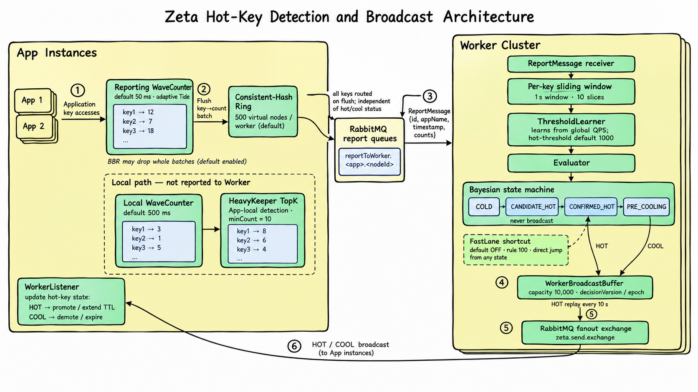

# Zeta

<p align="center">
  <a href="https://central.sonatype.com/artifact/io.github.hyshmily/zeta"></a>
  <a href="https://jitpack.io/#Hyshmily/Zeta"></a>
  <a href="https://github.com/Hyshmily/Zeta/releases"></a>
  <a href="https://github.com/Hyshmily/Zeta/actions/workflows/ci.yml"></a>
  <a href="https://coveralls.io/github/Hyshmily/Zeta?branch=master"></a>
  <a href="https://openjdk.java.net/"></a>
  <a href="https://spring.io/projects/spring-boot"></a>
  <a href="https://github.com/Hyshmily/zeta/commits/master"></a>
  <a href="https://www.apache.org/licenses/LICENSE-2.0"></a>
  <a href="https://visitor-badge.laobi.icu/badge?page_id=Hyshmily.zeta"></a>
</p>

[**English**](README.md)

Zeta 是一个自动化、高性能、低成本的轻量级分布式缓存与预热框架——无需预注册 key，热点发现、决策、预热、降级全链路自动闭环；以最小成本为集群突发热点提供最终一致性缓存，并通过 Redis 与 RabbitMQ 将业务代码与分布式协调基础设施完全解耦。

### 定位

**适合：**

- **不可预知的突发流量** —— HeavyKeeper 对任意 key 即时计数，无需预注册；Worker 学习期自动校准阈值
- **读多写少、单 key 被集中轰炸的集群** —— 热 key 自动延长 L1 TTL（默认 1h vs 5min），SingleFlight 合并回源防击穿
- **需要跨实例保持一致（最终一致）的缓存** —— 写穿透广播 + 每 key 版本守卫，增量成本仅为 Redis INCR + 一条 MQ 消息

**不适合：**

- **低流量稳态服务** —— 检测层常驻约 5MB 草图数组与十几个后台线程却永远空转，纯 Caffeine 足够
- **需要强一致逐写共识的场景** —— 同步语义为至多一次（ack-before-update）、版本探测失败 fail-open、宕机窗口内实例间短暂不一致是设计内行为；Zeta 按最终一致性设计

### 特点

| 能力              | 说明                                                                                                                                                                          |
| ----------------- | ----------------------------------------------------------------------------------------------------------------------------------------------------------------------------- |
| 本地热点检测      | 进程内 HeavyKeeper TopK 草图——热 key 自动延长 L1 Caffeine TTL，无需 Worker                                                                                                    |
| 集群检测与预热    | Worker 集群滑动窗口 + 贝叶斯置信度状态机；HOT key 直接从真实数据源（DB、远程服务）预热                                                                                        |
| 快车道 FastLane   | 延迟敏感 key（秒杀、突发新闻）的 glob 规则：达标即 `CONFIRMED_HOT`，全链路 ~60ms（P99）                                                                                       |
| 两级缓存          | Caffeine L1 + 命名缓存 loader 或一次性 reader 接任意后端；SingleFlight 防击穿、stale-while-revalidate、TTL 抖动防雪崩                                                                           |
| 跨实例一致性      | 写穿透广播 + 每 key 版本守卫——无需 Paxos/Raft 开销的最终一致                                                                                                                  |
| Spring Cache 融合 | `@Cacheable` / `@CachePut` / `@CacheEvict` 融合热点检测，外加 `@CacheTtl`、`@Intercept`、`@Fallback`、`@Preload` 等扩展注解（[docs/ANNOTATION.zh.md](docs/ANNOTATION.zh.md)） |
| 运行时运维        | Actuator 端点、FastLane 规则 REST API、决策 Hook 与 Handler SPI（[docs/MONITOR.zh.md](docs/MONITOR.zh.md)）                                                                   |

### 本地/集群检测

```java
private final Zeta zeta;

// 在同一命名空间中标记 key
zeta.tag("product:123");

// 获取 key
zeta.peek("product:123");
```

- **本地层（常开）：** 每个实例运行 HeavyKeeper TopK 草图。key 进入 TopK 集合即自动延长其 L1 Caffeine TTL——无需 Worker 反馈。L1 未命中由 SingleFlight 合并并发请求防击穿；软过期条目回陈旧值同时后台刷新，数据源故障时条目以永不缩短的续租（`max(剩余, floor, 剩余/2)`，floor 跟随条目自身量级）继续存活，而不是每次读都请求数据源（[ADR-0036](docs/adr/0036-lease-on-failure.md)，见 [ADR-0093](docs/adr/0093-explicit-outcomes-never-shorten-lease.md) 修订）。
- **集群层（可选）：** 实例计数经 CPU-BBR 背压上报至 RabbitMQ；Worker 集群运行双路径评估管线——**快车道**（glob 规则，达标即提升 `CONFIRMED_HOT`，全链路 ~60ms P99）与**贝叶斯路径**（Normal-Normal 共轭后验 + 逐 key 证据累积：强热点 ~50–150ms 确认，边界 key 跨评估窗口累积证据）。

<details>
<summary><b>具体实现</b></summary>

- `WaveCounter` 按键热度路由到两条路径：热键合并进写线程本地 map（零共享争用，每 128 次自增批量合并到共享表），冷键直接写入无锁共享表。每 500ms 周期交付一次快照
- 潮汐节奏是自适应的：`TidePacer` 在突发时把交付周期缩短至 50ms、空闲时加倍拉长；`MoonsTidalForce` 提升门槛调节器在续热键受阻时把门槛降到边界直接接纳（绝不棘轮上调），并带两个按流量分档的 regime 开关（低流量归 1、洪水时旧门槛一个 tide 塌缩归位）、有界带退避定价的探针 walk（[ADR-0045](docs/adr/0045-promotion-floor-governor.md)/[ADR-0051](docs/adr/0051-governor-probe-machine-bounds.md)/[ADR-0052](docs/adr/0052-governor-caffeine-refinements.md)/[ADR-0053](docs/adr/0053-density-priced-raise-stride.md)），以及方向可验证的否决回退——先实测实时信号再决定是否越过已确认的梯级（[ADR-0058](docs/adr/0058-direction-verified-veto-retreat.md)），且回退下降段本身也逐级实测实时续热率：路过首个健康梯级即就地停车，持续劣于自身起点即转向（[ADR-0059](docs/adr/0059-descent-slope-verified-retreat.md)）。提升边界本身是精确的（[ADR-0054](docs/adr/0054-exact-selection-promotion-boundary.md)）：边界值是该周期第 k 大计数的精确值，由 quickselect 在 log2 定位的桶内选出，并列时续热成员先于新来者重新提升——平坦分布下热集保持稳定；稳定负载下选择复用上一周期边界作为扫描过滤器，选择规模从整个桶降为约 `hotLimit` 个键（[ADR-0057](docs/adr/0057-kth-shortcut-exact-selection.md)）

- 每个应用实例运行一个本地 TopK 草图，跟踪高频访问的键。当键进入本地 TopK 集合时，其 L1 Caffeine 缓存的 TTL 会自动延长——无需等待 Worker 响应。L1 未命中时由 SingleFlight 机制合并同 key 并发请求，避免缓存击穿。同时支持软过期——在硬 TTL 到达之前，软 TTL 过期的条目可返回陈值并触发后台异步刷新，保障响应速度。若后台刷新失败，条目会以衰减续租（`max(剩余/2, 120s)`，[ADR-0036](docs/adr/0036-lease-on-failure.md)）继续存活——源故障从"每次读同步打源"变成后台重试，首次成功刷新后自动自愈。

- `KeyReporter` 将本地计数经第二套 WaveCounter（50ms 刷新节奏）聚合后，经 CPU-BBR 速率限制器（CPU 阈值 80%，滑动窗口 10s/100 桶）判定是否放行，通过 `DirectExchange` 批量上报至 RabbitMQ，路由键 `reportToWorker.{appName}.{target}`

- Worker 集群聚合所有应用实例的访问报告，运行**双路径评估管线**：
  - **快车道（FastLane）**：对匹配用户配置的 glob 规则的 key（如 `product:*`），滑动窗口求和直接与规则阈值比较。达标即提升为 `CONFIRMED_HOT`——无贝叶斯置信度门控、无确认窗口。默认参数设定下,全链路端到端延迟：**~60ms（P99）**。
  - **贝叶斯路径**：对所有其他 key，滑动窗口频率分析结合贝叶斯置信度状态机（Normal-Normal 共轭后验 + 逐 key 证据累积）产生决策:`HIGH（≥0.95）` → `CONFIRMED_HOT` 广播 HOT；`MEDIUM（[0.76, 0.95)）` → `CANDIDATE_HOT` 积累证据；`LOW（<0.76）` → 保留策略（前 2 次 `hotStreak=confirmCount-1` 快速重评，第 3 次完全重置）。提升延迟取决于流量强度：强热点 key（远超阈值）在 **~50–150ms** 内达到 CONFIRMED_HOT；边界 key（接近阈值）可能需要多轮评估窗口。

</details>

### 多节点缓存一致性

与主从数据库通过日志复制协议同步写入类似，Zeta 通过基于 RabbitMQ 的发布-订阅机制在各应用实例间同步缓存变更。

任一实例执行集群同步写（`put(key, value, PutOptions.synced())`）或失效操作时，递增每键的 dataVersion（通过 Redis INCR，本地降级模式使用回退版本）并将结果广播到所有对等实例——同步写会直接携带序列化后的值（PUT 广播，ADR-0098），对端比对版本后直接应用、无需回源。每个对等实例比对传入的 dataVersion 与本地版本——过时消息静默丢弃。Worker 全部宕机时本地 TopK 接管完整仲裁权，上报静默丢弃；Worker 恢复后通过更高版本号自动收回控制权，无需人工干预。

版本比对机制确保最终一致性，无需 Paxos 或 Raft 等分布式共识协议的开销。



基准测试：

基准测试（`HotHitBenchmark`/`RuleBenchmark`，Intel Ultra 9 285H，JDK 26）：

- `peek` **约 70M ops/s**（Caffeine 查询 + 解包，无副作用）
- `get`（L1 命中）单线程**约 28M ops/s**，8 线程聚合**约 59M ops/s**（全路径含 TopK + Reporter）
- `get`（L1 命中，10 条规则）**约 17M ops/s**（每次命中 +24ns memo 探测）
- `get`（L1 命中，1KB String 值）**约 29M ops/s**

HotKey受京东[hotkey](https://gitee.com/jd-platform-opensource/hotkey)项目启发,算法支持来自[Aegis](https://github.com/go-kratos/aegis)、[neural](https://github.com/yu120/neural/tree/master)

## 快速开始

### 1. 添加依赖

<details>
<summary><b>快速部署 YAML 模板</b></summary>

**本地 Local（App 侧）** — 引入 `zeta` 依赖即可运行，可按需取消注释

```yaml
zeta:
  # local 参数全部走默认值，无需显式配置

  # —— 可选功能，按需取消注释 ——
  # App上报worker
  #report:
  #  enabled: false

  # 跨实例缓存同步（需 spring-boot-starter-amqp + spring-boot-starter-data-redis）
  # sync:
  #   enabled: true

  # Spring Cache 集成（需 spring-boot-starter-cache）
  # spring-cache:
  #   enabled: true

  # Worker 决策监听（需 spring-boot-starter-amqp + spring-boot-starter-data-redis）
  # worker-listener:
  #   enabled: true
  # sync:
  #   enabled: true     # worker-listener 依赖 hotKeyClusterLoader (CacheLoader) Bean
  #                     # 自定义: 实现 CacheLoader -> @Bean（见下方"自定义数据源"说明）

  # 一致性哈希默认开启（通过心跳实现动态 Worker 路由）
  # local:
  #   consistent-hashing:
  #     enabled: true     #（默认已开启）
```

**单 Worker（独立部署节点）** — 添加 `spring-boot-starter-amqp`

```yaml
zeta:
  app-name: myapp # 【必须】App 侧与 Worker 侧共用同一个键
  worker:
    enabled: true
    # 一致性哈希默认开启；Worker 通过心跳自动注册

# 多 Worker 示例：3 台机器，相同 app-name
# 一致性哈希通过心跳自动将 key 路由到正确的 Worker
# 无需静态分片配置——只需增加机器即可,建议本地App优先部署再启动worker
```

**集群健康阈值** — 默认（`min-alive-workers: 0`）时，观测到至少 **三分之一的 Worker 存活**（向上取整，下限 1）即健康：如观测 3 台→1 台存活即健康；观测 5 台→2 台；观测 9 台→3 台。单幸存 Worker 有意视为健康（见 [ADR-0028](docs/adr/0028-records-based-one-third-cluster-health-threshold.md)）。设置 `min-alive-workers: N` 可要求绝对存活数。详见 [CONFIG.zh.md](docs/CONFIG.zh.md)。

**全部参数**
参考[CONFIG.zh.md](docs/CONFIG.zh.md)

</details>

#### 本地模式（App 侧）— Maven 依赖

**Maven Central**（无需额外仓库）：

```xml
<dependency>
  <groupId>io.github.hyshmily</groupId>
  <artifactId>zeta</artifactId>
  <version>1.1.57</version>
</dependency>
```

**JitPack**：

```xml
<repositories>
    <repository>
        <id>jitpack.io</id>
        <url>https://jitpack.io</url>
    </repository>
</repositories>

<dependency>
    <groupId>io.github.hyshmily</groupId>
    <artifactId>zeta</artifactId>
 <version>1.1.57</version>
</dependency>
```

**GitHub Packages**：

```xml
<repositories>
  <repository>
    <id>github</id>
    <name>GitHub Packages</name>
    <url>https://maven.pkg.github.com/hyshmily/zeta</url>
  </repository>
</repositories>

<dependency>
  <groupId>io.github.hyshmily</groupId>
  <artifactId>zeta</artifactId>
  <version>1.1.57</version>
</dependency>
```

#### Worker 节点（独立部署）— JAR / Docker

> [!IMPORTANT]
>
> **前置条件：**
> Redis+RabbitMQ

预构建镜像托管在 GHCR。

**拉取:** 使用具备 `read:packages` 权限的 GitHub PAT 登录：

```bash
echo $PAT | docker login ghcr.io -u hyshmily --password-stdin
```

**通过 docker compose 全栈启动**（含 Redis + RabbitMQ）：

```bash
docker compose -f worker/docker-compose.yml up -d
```

**扩缩容多个 Worker 实例：**

```bash
docker compose -f worker/docker-compose.yml up -d --scale worker=3
```

**单独运行**（外部 Redis + RabbitMQ）：

```bash
docker run -d --name zeta-worker -p 8080:8080 \
  -e SPRING_RABBITMQ_HOST=rabbitmq \
  -e SPRING_DATA_REDIS_HOST=redis \
  -e ZETA_WORKER_ENABLED=true \
  ghcr.io/hyshmily/zeta-worker:1.1.57
```

**直接运行 JAR**（无需 Docker）：

```bash
mvn clean package -pl worker
java -jar worker/target/zeta-worker-1.1.57.jar
```

### 2. 配置

默认local本地配置

**功能配置：**

| 功能              | 启用方式                                   | 说明                                                          |
| ----------------- | ------------------------------------------ | ------------------------------------------------------------- |
| Redis 二级缓存    | 添加 `RedisTemplate` Bean                  | 两级缓存，L2 兜底                                             |
| 跨实例同步        | `zeta.sync.enabled=true`                   | 基于 RabbitMQ 的缓存失效                                      |
| Worker Listener   | `zeta.worker-listener.enabled=true`        | 接收 Worker 的 HOT/COOL 决策                                  |
| Worker 模式       | `zeta.worker.enabled=true`                 | 运行专用 Worker 节点                                          |
| 访问上报          | `zeta.report.enabled=true`（默认）         | 向 Worker 上报访问次数                                        |
| Reporter 自我保护 | `zeta.local.reporter.enabled=true`（默认） | Reporter 刷盘的 BBR 背压保护                                  |
| Spring Cache 集成 | `zeta.spring-cache.enabled=true`           | `@Cacheable` / `@CachePut` / `@CacheEvict` 融合 Zeta 热点检测 |

完整属性参考见 [CONFIG.zh.md](docs/CONFIG.zh.md)。

### 3. 使用

完整属性参考见 [CONFIG.zh.md](docs/CONFIG.zh.md)。

**标记操作**（不读缓存，仅喂检测）

```java
// K. tag — 标记 key 为可能热点，不执行缓存读取
zeta.tag("product:456"); // 更新本地 TopK + 加入 Worker 报告队列

// L. tag 精细控制
zeta.tag("product:456", Zeta.TagMode.REPORT_ONLY); // 跳过检测，仍上报到 Worker
zeta.tag("product:456", Zeta.TagMode.DETECT_ONLY); // 本地检测，跳过 Worker 上报
```

**读操作**

```java
@Autowired
private Zeta zeta;

// A. peek — 仅查 L1，不加载、不做热点追踪
String r = zeta.peek("user:123"); // L1 未命中返回 null

// B. get — 两级读穿透（Redis 或任意后端）；null = miss（永不缓存，下次读取重新回源）
String val = zeta.get("user:123", () -> redisTemplate.opsForValue().get("user:123"), GetOptions.defaults());

// C. get 带 GetOptions — 每次调用独立的 TTL；软过期条目默认回陈旧值 + 异步刷新
User user = zeta.get("user:123", () -> loadUser(123),
    GetOptions.of(60_000L, 30_000L));
```

**命名缓存**（LoadingCache 风格 —— 构建一次，处处读取）

针对命名空间构建一次类型化 `ZetaCache<K,V>` 句柄，之后直接零参调用 `get`/`put`/`invalidate`——调用点不再传 loader。`hardTtl` 对应 `expireAfterWrite`，`softTtl` 对应 `refreshAfterWrite`；miss 与后台刷新都走标准读管线（SingleFlight 去重、熔断、Worker 上报）。

```java
ZetaCache<UserId, User> users = zeta.<UserId, User>newBuilder()
    .name("user")
    .keyCodec(UserId::value)
    .hardTtl(Duration.ofMinutes(5))
    .softTtl(Duration.ofMinutes(1))
    .build(key -> createExpensiveUser(key));

// 之后直接读取 —— 调用点无 loader：
User user = users.get(id);
Map<UserId, User> batch = users.getAll(ids);
```

> [!NOTE]
>
> - miss 与软失效刷新经标准读路径回调注册的 loader——SingleFlight 去重、熔断、Worker 上报全部生效；纯 L1 命中不会调用 loader。
> - **loader 在构建时固定：** 每次 call 的 options 只覆盖 TTL/语义——loader（包括其 `shouldCache` 准入决策）不能按调用替换。一次性数据源改用 String 门面：`zeta.get(key, loaderOrReader, GetOptions)` / `zeta.getAll(keys, reader, GetOptions)`。
> - 集群加成：Worker HOT 预热与 peer REFRESH 同样经 `hotKeyClusterLoader` Bean（默认 Redis）取值，热 key 可以直接从真实数据源（如数据库）预热，无需 Redis 值通道。
> - `null` 永不缓存：loader 返回 `null` 不写条目、下次读取重新回源；`put(key, null)` 抛出 `IllegalArgumentException`。容量（`maximumSize`）仍是全局 L1 配置（`zeta.local.cache.max-size`），不按缓存划分。

**Options API**（按调用族封闭的选项对象）

每个操作族提供以该族封闭选项 record 收尾的全控制形态——`GetOptions`（读）、`PutOptions`（写）、`InvalidateOptions`（失效），位于 `io.github.hyshmily.zeta.model`。每个 record 只携带本族生效的旋钮，错配的旋钮直接编译报错而不是静默无效。TTL 字段为延迟求值（每次调用最多一次），通过 `with*` 链定制。

```java
// P. get 带 GetOptions — 延迟 TTL 求值、陈旧策略、快速失败控制
GetOptions options = GetOptions.of(30_000L, 10_000L);

User user = zeta.get("user:123", () -> userRepo.findById("user:123"), options);

// Q. 快速失败读——loader/内部失败以异常形式抛出，而不是被吞成 miss；
// loader 返回 null 仍是空结果（永不缓存）
User user2 = zeta.get("user:123", () -> loadUser(123),
    GetOptions.of(60_000L, 30_000L).withFailOnError());
```

**写操作**

```java
// R. put — 纯缓存写，默认仅本地（"先改数据源，再 put" 由调用方编排）；
// put(key, null) 抛异常
zeta.put("user:123", newValue);

// S. put 开集群同步——版本号自增 + 带值 PUT 广播到对端
// （对端按版本比对后直接应用，无需回源；见 ADR-0098）
zeta.put("user:123", newValue, PutOptions.synced());

// T. put 带显式硬 TTL（仅本地）
zeta.put("user:123", newValue, PutOptions.of(60_000L, 0));

// U. invalidate——默认集群同步开启（对端立即删除本地副本）
zeta.invalidate("user:123", InvalidateOptions.defaults());

// U2. invalidate 仅本地——不发同步消息（仅适用于单实例部署）
zeta.invalidate("user:123", InvalidateOptions.localOnly());

// V. flushLocalEmergency — 紧急仅本地刷清
zeta.flushLocalEmergency();

// W. refresh — 版本守卫的重载：先分配版本再加载，并发的新写获胜，陈旧加载不会回退
zeta.refresh("user:123", () -> loadUser(123));
```

**自定义 per-entry TTL**

Zeta 使用**差异化 TTL**：热点 key 和普通 key 分别有独立默认值。per-call 覆盖在此基础上生效。

| Key 状态 | 硬 TTL（Caffeine 淘汰）         | 软 TTL（stale-while-revalidate）  |
| -------- | ------------------------------- | --------------------------------- |
| 普通     | `default-hard-ttl-ms`（5min）   | `default-soft-ttl-ms`（30s）      |
| 热点     | `default-hot-hard-ttl-ms`（1h） | `default-hot-soft-ttl-ms`（5min） |

```java
// 5 分钟硬 TTL + 30 秒软 TTL
String shopJson = zeta.get("shop:" + shopId,
    GetOptions.of(() -> redisTemplate.opsForValue().get("shop:" + shopId))
        .withHardTtl(TimeUnit.MINUTES.toMillis(5))
        .withSoftTtl(TimeUnit.SECONDS.toMillis(30)));

// 30 秒硬 TTL，软 TTL 用默认值
zeta.put("weather:" + city, weatherData, PutOptions.of(TimeUnit.SECONDS.toMillis(30), 0));
```

> [!NOTE]
> **缓存雪崩防护：** `TtlPolicy` 通过 `DelayUtil.computeTtlJitter()` 对每个过期时间戳施加均匀随机偏移（默认 ±5%）。5 分钟硬 TTL 在默认偏移下实际到期 4.75 ~ 5.25 分钟。通过 `zeta.local.ttl-jitter-ratio`（比例，默认 `0.05` = ±5%,`0`为禁用）控制。

> [!TIP]
> per-call TTL 语义：传入 `0` 表示使用该 key 状态的配置默认值。彻底逻辑过期（纯软过期，硬 TTL 永不淘汰）：通过 `GetOptions.of(reader).withHardTtl(Long.MAX_VALUE).withSoftTtl(softTtlMs)` 传入 `hardTtlMs = Long.MAX_VALUE`，entry 永久驻留 Caffeine。此用法受 Caffeine `Expiry` JavaDoc 明确支持：_"To indicate no expiration an entry may be given an excessively long period, such as `Long.MAX_VALUE`."_ ([源码](https://github.com/ben-manes/caffeine/blob/master/caffeine/src/main/java/com/github/benmanes/caffeine/cache/Expiry.java))

## Worker 模式

Worker 模式通过专用节点提供集群维度热点检测。App 实例定期报告访问计数，Worker 运行滑动窗口+状态机管道，将 HOT/COOL 决策广播回所有实例。状态机参数（`confirmCount`、`coolCount`、`preCoolGraceCount`）可通过 `/actuator/hotkey/worker/state` 运行时调整。

| 模式        | `worker.enabled` | 激活的 Bean                                                          |
| ----------- | ---------------- | -------------------------------------------------------------------- |
| App-only    | `false`（默认）  | `HotKeyCache`、TopK、reporter、actuator、sync                        |
| Worker-only | `true`           | 仅 Worker（无缓存——`get()`/`put()` 抛出 `ZetaModeException`）        |

**Worker 集群健康：** 观测到至少三分之一的 Worker 存活（向上取整，下限 1）即健康——如观测 3 台→1 台存活即健康；观测 9 台→3 台。单幸存 Worker 有意视为健康集群：Worker 侧上报流量已批量聚合，幸存者可承担集群服务；仅当观测 Worker 存活数不足三分之一时才触发降级（本地 COOL→HOT 接管）。可通过 `zeta.local.heartbeat.min-alive-workers: N` 设置绝对最小值（见 [ADR-0028](docs/adr/0028-records-based-one-third-cluster-health-threshold.md)）。

**快车道（FastLane，立即提升旁路）：** FastLane 是一条绕过贝叶斯置信度门控的评估路径。匹配用户配置的 glob 规则的 key（如 `product:*`），只要滑动窗口计数达到规则阈值，立即提升为 `CONFIRMED_HOT`——无需确认窗口、无需置信度评分、无需连续计数累积。全链路端到端延迟：**~60ms（P99）**。FastLane 仅在 `zeta.worker.fast-lane.enabled=true`（默认 `false`）时生效——只配置规则不会激活该路径。

启动时通过配置文件设置 FastLane 规则：

```yaml
zeta:
  worker:
    fast-lane:
      enabled: true # 必须显式开启——门控真实生效（默认 false）
      rules:
        - key-pattern: "product:*" # glob 模式
          threshold: 500 # 滑动窗口计数阈值
        - key-pattern: "flashsale:*"
          threshold: 1000
        - key-pattern: "news:breaking:*"
          threshold: 200
```

也可通过 Actuator REST API 在运行时管理规则（无需重启）：

| 方法     | 路径                                  | 操作         |
| -------- | ------------------------------------- | ------------ |
| `GET`    | `/actuator/hotkey/fastlane`           | 列出所有规则 |
| `POST`   | `/actuator/hotkey/fastlane`           | 添加规则     |
| `PUT`    | `/actuator/hotkey/fastlane`           | 更新规则阈值 |
| `DELETE` | `/actuator/hotkey/fastlane/{pattern}` | 删除规则     |

示例：`curl -X POST -H 'Content-Type: application/json' -d '{"keyPattern":"promo:*","threshold":300}' http://worker:8080/actuator/hotkey/fastlane`

**FastLane 状态转换：** 匹配的 key 从任何当前状态（COLD、CANDIDATE_HOT、PRE_COOLING）直接跃迁到 `CONFIRMED_HOT`。`hotStreak` 立即设为所需的确认计数，`coolStreak` 重置为 0，并广播 HOT 决策——即使从 PRE_COOLING 状态（正常路径下静默恢复会抑制广播）。已经是 CONFIRMED_HOT 的 key 仅刷新时间戳。

**适用场景：** 秒杀商品 ID、突发新闻 slug、促销活动 key——任何可容忍一定误报、需要亚秒级检测延迟的场景。对于需要高置信度、低误报率的 key，应使用默认的贝叶斯路径。

### 说明

**`hot-threshold: -1` 在学习期内禁用热点检测**

当 `zeta.worker.threshold.hot-threshold` 设为 `-1`（比例模式）时，Worker 将滑动窗口阈值初始化为 `Long.MAX_VALUE`——实际上在 30 秒学习期（`learning-period-ms`，默认 30s）内没有任何 key 能被分类为 HOT。学习期结束后，`ThresholdLearner` 计算 `threshold = globalQps × hotThresholdRatio`，恢复正常运作。

**缓解措施：** 配合设置一个合理的绝对阈值：

```yaml
zeta:
  worker:
    threshold:
      hot-threshold: 1000 # 学习期内的回退阈值
    global-qps-dynamic-threshold:
      learning-period-ms: 5000 # 缩短学习期加速收敛
```

或在流量模式已知的情况下直接禁用学习期（`learning-period-ms: 0`）。

**Worker 广播 Exchange 声明**

Worker 模块（`zeta-worker`）已将广播 exchange（默认 `zeta.send.exchange`）声明为 Spring `FanoutExchange` bean。如果通过非 `WorkerAutoConfiguration` 的方式独立部署 Worker，需要确保该 exchange 在 RabbitMQ 中存在——否则 Worker 的 HOT/COOL 广播会因 channel 级 `not_found` 异常而失败。

**心跳 Exchange 的声明顺序**

在全新的 broker 上，Worker 会在**控制面连接被用于发布之前**声明 `zeta.heartbeat.exchange`，因此冷启动集群的第一个 Worker 不再打印 `NOT_FOUND - no exchange 'zeta.heartbeat.exchange'`。（以前会：仅第一个 Worker 打印两条 `ERROR`——心跳交换机原先由 Spring Boot 的 `RabbitAdmin` 惰性声明，而心跳生产者自己开连接，发布可能抢在声明之前，导致该拍心跳与 fast-lane 规则 gossip 丢失，一个周期后自愈。）该声明挂在 Zeta 为心跳与规则 gossip 构建的控制面 `RabbitTemplate` 上，幂等且 durable，因此独立部署的 App 也能受益。

其余对象（`zeta.send.exchange`、`zeta.reportToWorker.exchange`、sync exchange）仍由 Boot 的 `RabbitAdmin` 惰性声明，因此冷启动时仍可能出现一次性 `NOT_FOUND`，且同样无害——判据是 App 侧健康环是否变为非空，详见 [CONFIG.zh.md](docs/CONFIG.zh.md)。**不要**为了提前声明而新增第二个 `AmqpAdmin`/`RabbitAdmin` bean：Boot 的 admin 由 `@ConditionalOnMissingBean` 按返回类型把关，多一个 admin 会静默顶掉它，导致所有交换机、队列、绑定都不再被声明。

**共享 broker 的 appName 隔离（[ADR-0068](docs/adr/0068-broadcast-app-name-isolation.md)）**

每条 HOT/COOL 决策广播都携带 `appName` 头（取自共享的 `zeta.app-name`），App 侧监听器会丢弃与自身不同的决策——fanout 交换机忽略 routing key，多应用共用一个 RabbitMQ 时，否则 A 应用的决策会触发 B 应用的无效预热。两条兼容规则：**不带** `appName` 头的消息（旧版 Worker，滚动升级窗口）一律照常处理；未配置 `app-name` 的应用保持原有全收行为。两端 `app-name` 不一致时决策会被静默丢弃（DEBUG 日志可见），务必保持一致。详见 [ADR-0068](docs/adr/0068-broadcast-app-name-isolation.md)。

**PING/PONG 验证是辅助手段**

`WorkerHeartbeatVerifier` 定期向**非存活**状态（心跳超时超过 `heartbeat.timeout-ms`，默认 10s）的 Worker 发送 PING。启动时的瞬态失败是预期的且安全的——首次 PING 可能在 Worker 的 verify 队列就绪前发出。主心跳路径（Worker → `zeta.heartbeat.exchange` → App 心跳队列）是 HealthView 更新和 RingManager 路由的权威机制。

**自定义 HOT 提升的数据源**

当 Worker 广播某个 key 的 HOT 决策时，App 侧的 `WorkerListener` 会通过 `CacheLoader.load(key)` 加载权威值，然后将该 entry 以扩展 TTL 提升到 L1。默认实现从 Redis 读取（`RedisValueLoader`）。

要使用其他数据源（数据库、远程服务等），提供自己的 `CacheLoader<String, Object>` Bean 即可：

```java
@Bean
@ConditionalOnMissingBean(name = "hotKeyClusterLoader")
public CacheLoader<String, Object> dbCacheLoader(YourRepository repo) {
  return key -> {
    // 从 key 命名约定解析实体类型，如 "User:123"
    // → 表 "users"，id=123；查询数据库并返回值
    return repo.loadByKey(key);
  };
}
```

`@ConditionalOnMissingBean(name = "hotKeyClusterLoader")` 确保你的 Bean 替换默认的 `RedisValueLoader`。`WorkerListener.handleHot()` 和 `CacheSyncListener.handleRefresh()` 都通过此 Bean 获取值——无需其他配置变更。返回 `null` 表示"数据源中不存在"——该值永不缓存，下次读取重新回源。

**通过 Hook 观察广播决策**

实现 `WorkerDecisionHook` 或 `SyncHook` 接口来观察广播处理结果，而无需修改核心逻辑：

```java
@Bean
public WorkerDecisionHook myMonitorHook() {
  return new WorkerDecisionHook() {
    @Override
    public void afterHotPromotion(String cacheKey, WorkerMessage wm, CacheEntry entry) {
      metrics.counter("hot.promotion").increment();
    }

    @Override
    public void onHotSkipped(String cacheKey, WorkerMessage wm, HotSkipReason reason) {
      log.warn("HOT 跳过 {}：{}", cacheKey, reason);
    }
  };
}
```

| Hook                 | 方法                 | 触发时机                            |
| -------------------- | -------------------- | ----------------------------------- |
| `WorkerDecisionHook` | `afterHotPromotion`  | Key 被提升为 HOT（扩展 TTL）        |
| `WorkerDecisionHook` | `afterCoolDowngrade` | Key 恢复为普通 TTL                  |
| `WorkerDecisionHook` | `onHotSkipped`       | HOT 被跳过（限流/版本过旧/无值）    |
| `WorkerDecisionHook` | `onCoolSkipped`      | COOL 被跳过（L1 中无对应 entry）    |
| `SyncHook`           | `afterRefresh`       | 因对端广播而从数据源刷新 key        |
| `SyncHook`           | `afterInvalidate`    | 因对端广播而从 L1 移除 key          |
| `SyncHook`           | `onRefreshSkipped`   | REFRESH 被跳过（版本过旧/值不存在） |

所有方法都是 `default` 空实现，只需实现需要的即可。单个 hook 抛异常不影响其他 hook 和广播处理。多个 hook Bean 按序执行。

**替换默认的广播处理逻辑**

如需完全控制 HOT/COOL 决策或缓存同步消息的处理方式，实现策略接口并将 Bean 暴露为 `@ConditionalOnMissingBean`：

```java
@Bean
@ConditionalOnMissingBean(WorkerDecisionHandler.class)
public WorkerDecisionHandler myHandler() {
  return new WorkerDecisionHandler() {
    @Override
    public void handleHot(WorkerMessage wm) {
      // 自定义 HOT 逻辑——替代 Redis 加载、DCL、compute 等
    }

    @Override
    public void handleCool(WorkerMessage wm) {
      // 自定义 COOL 逻辑——替代 TTL 重置、key 状态变更等
    }
  };
}
```

| 接口                    | 方法                                                                                    | 替换的默认行为                                                          |
| ----------------------- | --------------------------------------------------------------------------------------- | ----------------------------------------------------------------------- |
| `WorkerDecisionHandler` | `handleHot`, `handleCool`                                                               | `WorkerListener` 的默认 HOT/COOL 处理（Redis 加载、SRE 限流、版本守卫） |
| `SyncDecisionHandler`   | `handleRefresh`, `handleLocalInvalidate`, `handleLocalInvalidateAll`, `handleRulesSync` | `CacheSyncListener` 的默认缓存同步处理                                  |
| `Evaluator`             | `evaluate`, `evictStale`（default 空实现）                                              | Worker 的热点检测管线（快车道 + 贝叶斯置信度状态机）                    |

`DefaultWorkerDecisionHandler`、`DefaultSyncDecisionHandler` 仍然会调用已注册的 `WorkerDecisionHook` / `SyncHook` Bean。自定义实现可以选择是否调用 hook。

`Evaluator` 支持两种方式——**完全替换**或**包装默认实现**：

```java
// 方式 1：完全替换——完全绕过默认评估管线。
// 不涉及滑动窗口、CV、EMA、贝叶斯门控。
@Bean
@ConditionalOnMissingBean(Evaluator.class)
public Evaluator myEvaluator() {
  return (key, count) -> {
    if (key.startsWith("priority:")) return ZetaDecision.hot(key, null);
    return ZetaDecision.none(key, null);
  };
}
```

```java
// 方式 2：包装默认实现——先跑默认评估，再附加副作用。
@Bean
public Evaluator wrappedEvaluator(DefaultEvaluator delegate) {
  return new Evaluator() {
    @Override
    public ZetaDecision evaluate(String key, long count) {
      ZetaDecision decision = delegate.evaluate(key, count);
      metrics.counter("eval." + decision.type().name()).increment();
      return decision;
    }
    // evictStale 是 default 空实现——这里不需要重写
  };
}
```

注意：包装时**不能**加 `@ConditionalOnMissingBean`（否则你的包装器阻止自己创建）。直接将 `DefaultEvaluator` 注入为依赖，选择性地测量或扩展。

## Spring Cache 集成

启用 `zeta.spring-cache.enabled=true`。标准 `@Cacheable` / `@CachePut` / `@CacheEvict` 自动通过 Zeta 的热点检测、软过期和跨实例同步路由。

**需要 `@EnableCaching`：** `CacheExtensionAspect` 包装在 Spring 的 `CacheInterceptor` 外层——没有 `@EnableCaching`，该拦截器不会注册，`@Cacheable` 方法会执行但结果不会被缓存。

```java
@SpringBootApplication
@EnableCaching
@EnableScheduling
public class MyApplication { ... }
```

**扩展注解**（由 `CacheExtensionAspect` 以 `HIGHEST_PRECEDENCE` 优先级处理；完整组合矩阵见 [docs/ANNOTATION.zh.md](docs/ANNOTATION.zh.md)）：

| 注解              | 目标 | 在 `@Cacheable` 上的作用                                                                                                                                                                                                                                                     |
| ----------------- | ---- | ---------------------------------------------------------------------------------------------------------------------------------------------------------------------------------------------------------------------------------------------------------------------------- |
| `@CacheTtl`       | M/T  | 覆盖硬/软 TTL。静态值与 SpEL（`hardTtlSpEl`、`softTtlSpEl`）。SpEL 每次调用最多求值一次，仅在 miss/提升/刷新时                                                                                                                                                               |
| `@Intercept`      | M    | 通过触发模式（`IS_LOCAL_HOT`/`FORCE`/`QPS`/`CONCURRENT_THREADS`）跳过方法体。模式专属配置通过嵌套 `@Intercept.QpsConfig`（`threshold`、`blockDurationMs`）和 `@Intercept.ConcurrentConfig`（`threshold`）。fallback 优先级：`@Intercept.fallback()` → `@Fallback` → `peek()` |
| `@Fallback`       | M    | 回退值（SpEL）或命名约定方法（`{methodName}Fallback`），被拦截/异常时调用                                                                                                                                                                                                    |
| `@SkipSync`       | M    | 禁止跨实例同步消息（仅本地写/失效）                                                                                                                                                                                                                                          |
| `@Preload`        | M    | 预膨胀 HeavyKeeper 计数（静态 `keys[]` 或动态 `keyExpr` SpEL）                                                                                                                                                                                                               |
| `@CacheCondition` | M    | SpEL `unless`，清除语义——结果不保留且已存在条目被失效（除非 `@SkipSync`，否则同步）                                                                                                                                                                                          |
| `@Tag`            | M    | 将 SpEL 解析的 key 送入检测/上报，不做缓存查找；`skipDetection`/`skipReport` 分别抑制一侧；`cacheName` 对齐 key 命名空间                                                                                                                                                     |

```java
@Cacheable(cacheNames = "users", key = "#id")
@CacheTtl(hardTtlMs = 60000, softTtlMs = 10000)
@Intercept @Fallback
public User getUser(Long id) { ... }

// 动态 TTL
@Cacheable(cacheNames = "users", key = "#id")
@CacheTtl(hardTtlSpEl = "#id.startsWith('vip') ? 600000 : 60000")
@Intercept
public User getUserVip(Long id) { ... }

// QPS 限流拦截（嵌套 @Intercept.QpsConfig）
@Cacheable(cacheNames = "products", key = "#id")
@Intercept(type = InterceptType.QPS, qps = @Intercept.QpsConfig(threshold = 500), fallback = "'throttled'")
@Fallback
public Product getProduct(String id) { ... }

// QPS 限流 + 冷却封锁（超限后冷却 5s）
@Cacheable(cacheNames = "flash-sale", key = "#id")
@Intercept(type = InterceptType.QPS, qps = @Intercept.QpsConfig(threshold = 100, blockDurationMs = 5000))
public Item getFlashItem(String id) { ... }

// 并发线程数限流（嵌套 @Intercept.ConcurrentConfig）
@Cacheable(cacheNames = "orders", key = "#id")
@Intercept(type = InterceptType.CONCURRENT_THREADS, concurrent = @Intercept.ConcurrentConfig(threshold = 10), fallback = "'busy'")
@Fallback
public Order getOrder(Long id) { ... }

// 热点预加载
@Cacheable(cacheNames = "flash", key = "#id")
@Preload(keys = {"item-001", "item-002"})
@Intercept
public String getFlashItem(String id) { ... }

// 结果被禁用时清除缓存
@Cacheable(cacheNames = "products", key = "#id")
@CacheCondition(unless = "#result == null || #result.disable()")
public Product getProduct(String id) { ... }

// 在同一命名空间中标记 key，不做缓存查找
@Tag(value = "#id", cacheName = "products", skipReport = true)
public void touchProduct(String id) { ... }

// 仅本地写，不跨实例同步
@CachePut(cacheNames = "local", key = "#id")
@SkipSync
public String updateLocal(String id, String val) { ... }
```

需 classpath 中包含 `spring-boot-starter-cache` 和 `spring-boot-starter-aop`。

## 缓存同步

启用 `zeta.sync.enabled=true`。

读路径条目(L1 miss、软过期刷新)会以值读取后探测到的 Redis `dataVersion` 盖章(批量装载走 pipeline),迟到的过期广播会被共享的版本比较拒绝,而不会覆盖更新的值。探测失败时条目不盖章(fail-open);详见 [ADR-0033](docs/adr/0033-read-path-version-stamping.md)。

## 规则系统

启用 `zeta.sync.enabled=true` 以启用跨实例规则同步。规则系统提供两种操作：

| 操作              | 对匹配 key 的效果                                                                |
| ----------------- | -------------------------------------------------------------------------------- |
| `BLOCK`           | `get()` / `getAll()` 抛出 `ZetaBlockedException`；`put()` 跳过     |
| `ALLOW_NO_REPORT` | 正常处理但跳过 Worker 上报（减少频繁访问 key 的噪音）                            |

### 模式类型

`RuleMatcher.of(pattern, action)` 自动检测模式：

| 模式                | 类型       | 匹配                       |
| ------------------- | ---------- | -------------------------- |
| `"user:123"`        | `EXACT`    | 精确 key                   |
| `"temp:*"`          | `PREFIX`   | 以 `temp:` 开头的 key      |
| `"order:*-detail"`  | `WILDCARD` | Glob 风格（`*` / `?`）匹配 |
| `"regex:user:\\d+"` | `REGEX`    | Java 正则                  |

### 持久化与分发（ADR-0099：Redis 是唯一通道）

- **有 Redis：** 每次 `addRule()`/`removeRule()`/`clearRules()` 通过版本化 Lua CAS 将规则列表序列化写入 `ZetaConstants.Redis.KEY_RULES`（`"zeta:rules"`）。启动时 `RuleMatcher.initRules()` 从 Redis 加载并恢复持久化的 `rulesVersion`（[ADR-0062](docs/adr/0062-rule-sync-version-authoritative-replace.md)）。守护轮询（`zeta-rules-reload`，每 30 秒）重新加载持久化规则集，并在其版本不低于本地版本时采纳——对端变更仅通过 Redis 收敛，删除与清空通过全量替换收敛。
- **无 Redis：** 规则仅保留在持有它的节点内存中（无跨实例分发）。

## 监控

Zeta 提供两种互补的监控机制

完整响应格式和字段说明见 [MONITOR.zh.md](docs/MONITOR.zh.md)（[英文版](docs/MONITOR.md)）。

## 设计细节

领域术语定义见 [CONTEXT.md](CONTEXT.md)。
架构决策记录（ADR）维护在 [docs/adr/](docs/adr/0001-local-promotion-worker-fallback.md)。

## License

Apache License 2.0
